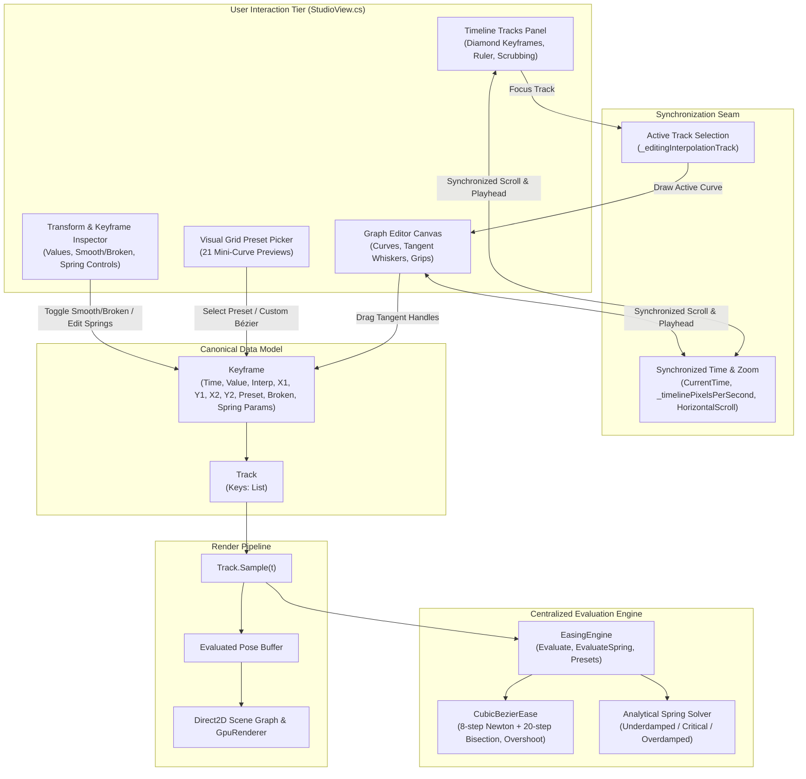

# Phase 4: Easing, Interpolation and Graph Editor Reconstruction - Research

**Researched:** 2026-11-06  
**Domain:** Motion graphics easing mathematics, analytical spring simulation, WPF/Direct2D curve rendering, interactive graph editor widgets  
**Confidence:** HIGH  

<user_constraints>
## User Constraints (from CONTEXT.md)

### Locked Decisions

- **D-01:** Vertical Split Panel:
  The Graph Editor is integrated as a vertical split panel directly below the track lanes within the bottom timeline area, with a resizable splitter. When entering Animate Mode, it is open by default, with a toggle button on the timeline toolbar to collapse/expand it.
- **D-02:** Unified Synchronized Time:
  Horizontal scrolling, zoom level, and playhead position are 100% synchronized between the track lanes and the Graph Editor canvas; the playhead indicator line cuts seamlessly across both views.
- **D-03:** Single Active Track Focus:
  The Graph Editor displays the curve for the single active property track clicked in the timeline, keeping the canvas clean and readable.
- **D-04:** Value Graph Primary with Auto-Fit Framing:
  Vertical axis displays actual property values (pixels, degrees, scale ratio, opacity %) with auto-fit framing keyframe min/max values with margins. Supports vertical drag to pan, Ctrl+wheel to zoom value axis, and 'F' key to reframe keyframes to fit. Supports toggle to Speed/Velocity Graph.
- **D-05:** Handle-Only Editing on Graph Canvas:
  Keyframe points are fixed in time and value on the graph canvas (time and values adjusted in timeline and inspector); dragging on the graph canvas is strictly dedicated to manipulating tangent control handles to avoid accidental timing/value drift.
- **D-06:** Aligned Tangents with Alt-Break:
  Incoming and outgoing tangent handles are aligned/collinear by default (180° continuous slope for smooth C1 velocity continuity). Alt-dragging breaks the handle into independent/sharp angles. The inspector provides explicit "Smooth" and "Broken" toggle buttons.
- **D-07:** Free Vertical Overshoot, Clamped Horizontal Time:
  Vertical tangent coordinates ($y_1, y_2$) can freely overshoot ($y < 0.0$ or $y > 1.0$) to support bouncy, anticipatory, and elastic curves. Horizontal coordinates ($x_1, x_2$) are constrained to $[0.0, 1.0]$ within the segment duration to guarantee monotonic time and prevent root-solver inversion.
- **D-08:** Tangent Handle Snapping & Styling:
  Handles feature crisp square/diamond keyframe nodes with thin whisker lines leading to circular grip knobs (Teal for incoming, Amber for outgoing) with a 10px hit-test radius. Holding Shift snaps handle angles flat (0 slope) or to 45°, with magnetic snapping to 0.0 and 1.0 values.
- **D-09:** Analytical Spring Solver & Segment Configuration:
  Spring interpolation uses a closed-form analytical damped harmonic oscillator solution ($m, k, c, v_0$), enabling instantaneous, deterministic random-access scrubbing without iterative simulation drift. Physical parameters (Mass, Stiffness, Damping, Initial Velocity) are exposed in the inspector alongside one-click spring presets (Gentle, Snappy, Bouncy, Stiff).
- **D-10:** Evaluated Damped Waveform Visualization:
  Spring segments in the Graph Editor are rendered by sampling the analytical damped wave equation directly, accurately showing overshoot peaks, ripple cycles, and settling threshold.
- **D-11:** Visual Grid Preset Picker & Custom Bézier Transition:
  The 21 easing presets are browsable via a visual popover grid with miniature curve previews. Modifying any tangent handle or numeric control point immediately switches the preset status to "Custom Bézier", preserving user curve edits.
- **D-12:** Canonical Data Model & Evaluator Integration:
  `Keyframe` and `Track` remain the single source of truth. Starting keyframe owns the outgoing segment interpolation (`InterpMode.Hold`, `Linear`, `Cubic`, `Spring`). `Track.Sample` calls the centralized interpolation engine, updating the canvas in real time during scrubbing and handle dragging.

### The Agent's Discretion

- Mathematical formulations for the 21 presets (Quad, Cubic, Quart, Quint, Back, Elastic, Bounce standard formulas).
- Visual color palette for grid lines, curve strokes, and grip highlights (following KerfBrand guidelines: `#06B6D4` Teal, `#F59E0B` Amber, `#13161D` dark background, `#313845` subtle grid lines).
- Tolerance threshold for spring settling (e.g. 0.1% amplitude cutoff = 0.001).

### Deferred Ideas (OUT OF SCOPE)

- Interactive state machine blend trees and transition curve editor (Phase 6).
- Velocity graph editing (dragging speed handles instead of value handles) - Value Graph is primary for Phase 4; speed graph mode can be expanded in Phase 6/7.
- Full undo/redo history for tangent handle manipulation (Phase 5).
</user_constraints>

<phase_requirements>
## Phase Requirements

| ID | Description | Research Support |
|----|-------------|------------------|
| **EASE-01** | Precision cubic Bézier easing math supporting custom control points $(x_1, y_1, x_2, y_2)$, vertical overshoot, 21 easing presets, and analytical closed-form harmonic springs | Detailed mathematical formulas verified for 8-iteration Newton-Raphson + bisection fallback, unconstrained vertical overshoot ($y_1, y_2 \in \mathbb{R}$), all 21 motion presets, and the 3 regimes (underdamped, critical, overdamped) of closed-form damped harmonic springs. |
| **EASE-02** | Interactive Direct2D / WPF curve/graph editor widget displaying property curves over time | Complete specification of a vertical split panel below timeline tracks with resizable `GridSplitter`, synchronized horizontal pan/zoom, playhead continuity, and Value Graph rendering with auto-fit framing. |
| **EASE-03** | Draggable tangent control handles allowing intuitive curve sculpting on selected keyframes | Hit-testing algorithms (10px grip radius), circular grip styling (Teal incoming, Amber outgoing), 180° continuous collinear tangent enforcement, Alt-key angle breaking, and Shift snapping (0° flat, 45°, 0.0/1.0 magnetic). |
| **EASE-04** | Synchronized playhead and real-time canvas preview during curve editing | Real-time `Track.Sample` dispatch to `EasingEngine.Evaluate`, immediate canonical document model updating on handle manipulation, and playhead scrubbing with zero-latency visual synchronization. |
</phase_requirements>

## Summary

Phase 4 reconstructs the motion curve editing and easing architecture of Kerf Studio, transforming it into an industrial-grade animation system. The core deliverable consists of two tightly coupled pillars:
1. **A mathematically unified easing and interpolation engine (`EasingEngine.cs`)**: Centralizes evaluation of Hold, Linear, Cubic Bézier with free vertical overshoot ($y_1, y_2 \in \mathbb{R}$), 21 motion presets (Linear, Ease, EaseIn, EaseOut, EaseInOut, Quad In/Out/InOut, Cubic In/Out/InOut, Quart In/Out/InOut, Quint In/Out/InOut, Back, Elastic, Bounce, Smooth), and a closed-form analytical damped harmonic oscillator spring solver ($m, k, c, v_0$) enabling deterministic, drift-free random-access timeline scrubbing.
2. **A professional Graph Editor canvas widget (`GraphEditorCanvas`)**: Integrates directly as a vertical split panel below timeline tracks with a resizable `GridSplitter`, full horizontal time synchronization (scrolling, zoom level, cutting playhead needle), single-active-track focus, Value Graph auto-fit framing ('F' key), and handle-only tangent manipulation with 180° collinear slope alignment, Alt-drag breaking, Shift angle snapping, and a 21-preset visual grid popover.

All implementations strictly adhere to C# 5.0 compatibility (.NET Framework 4.8), ensuring seamless integration into the existing native Windows compilation pipeline without third-party dependencies or external runtimes.

**Primary recommendation:** Centralize all curve and physics evaluations in `Kerf.Engine.Animation.EasingEngine`, expand `Keyframe` with spring parameters and tangent alignment metadata, integrate `GraphEditorCanvas` directly below the timeline lanes with synchronized scroll viewers, and wire `Track.Sample` to dispatch through `EasingEngine`.

---

## Architectural Responsibility Map

| Capability | Primary Tier | Secondary Tier | Rationale |
|------------|-------------|----------------|-----------|
| **Cubic Bézier Root Solving** | Backend Math Engine (`CubicBezierEase.cs`) | — | Pure numerical root finding ($x(s) = u \implies s$) via Newton-Raphson + Bisection fallback; must run headless for tests and CLI builds. |
| **Analytical Spring Evaluation** | Backend Math Engine (`EasingEngine.cs`) | — | Closed-form ODE solution; must compute instantaneously during scrubbing and playback without state accumulation. |
| **Preset Definitions & Conversions** | Backend Math Engine (`EasingEngine.cs`) | UI Preset Picker (`StudioView.cs`) | Single source of truth for canonical $(x_1, y_1, x_2, y_2)$ control points and mathematical evaluation formulas. |
| **Track Sampling Dispatch** | Animation Evaluator (`Track.Sample`) | Timeline Transport (`AnimationTimelineController.cs`) | `Track.Sample(t)` dispatches to `EasingEngine` to produce interpolated property values for any requested timestamp. |
| **Graph Editor Canvas & Rendering** | UI Component Layer (`GraphEditorCanvas.cs` / `StudioView.cs`) | Direct2D / WPF MilCore | Renders value axes, grid lines, Bézier segments, evaluated spring waveforms, and playhead indicator. |
| **Tangent Handle Interaction** | UI Component Layer (`StudioView.cs`) | Command History (Phase 5) | Pointer capture, 10px hit-testing, collinear tangent updates, Alt-drag breaking, and Shift snapping. |
| **Synchronized Time & Playhead** | Timeline Controller (`StudioView.cs`) | UI Scroll Viewers | Shared `_timelinePixelsPerSecond` and synchronized `HorizontalOffset` across tracks and graph canvas. |
| **Visual Grid Preset Picker** | UI Inspector Popover (`StudioView.cs`) | Easing Engine | Grid popover rendering miniature 48×32 curve previews and applying presets to selected keyframes. |

---

## Standard Stack

### Core
| Library / Component | Version | Purpose | Why Standard |
|---------------------|---------|---------|--------------|
| **.NET Framework 4.8 (C# 5.0)** | 4.8.9221.0 | Core Language & Runtime | Mandatory project compiler (`csc.exe` in `C:\Windows\Microsoft.NET\Framework64\v4.0.30319`); guarantees zero external runtime dependencies. |
| **WPF PresentationCore / PresentationFramework** | 4.0.0.0 | UI Layout, Canvas & Geometry | Hardware-accelerated vector rendering via `PathGeometry`, `StreamGeometry`, `BezierSegment`, and `PolyLine`. |
| **WindowsBase** | 4.0.0.0 | Primitives & Vector Math | Provides `System.Windows.Point`, `Vector`, `Rect`, and `Matrix` for 2D transforms and distance calculations. |
| **System.Web.Script.Serialization** | 4.0.0.0 | Project Persistence | Native JSON serialization of `Keyframe`, `Track`, and `Clip` properties into `.kerf` document files. |

### Supporting
| Component | Purpose | When to Use |
|-----------|---------|-------------|
| `KerfBrand` | Brand Color Palette | Standard theme tokens (`MintBrush` `#46EFB1`, `AmberBrush` `#F6B322`, `DarkSlateBrush` `#2C2C2C`, `FigmaBorderBrush` `#383838`). |
| `AnimationTimelineController` | Centralized Clock & Transport | Tracks current playback time, FPS, duration, seek, and loop mode. |
| `PropertyBinder` | Non-destructive Layer Posing | Applies evaluated track values directly to layer `RenderTransform` without altering document layout bounds. |

### Alternatives Considered
| Instead of | Could Use | Tradeoff |
|------------|-----------|----------|
| **Closed-Form Spring Solver** | Euler / Verlet Iterative Physics Step | Iterative simulation suffers from frame-rate dependent accumulation drift and cannot support random-access timeline scrubbing. Analytical closed-form solution allows $O(1)$ random access at any timestamp. |
| **WPF Native PathGeometry** | Raw Direct2D Immediate Context (`ID2D1RenderTarget`) | WPF `PathGeometry` with `BezierSegment` compiles directly into DirectX geometry in MilCore, retaining standard WPF hit-testing, mouse events, and DPI scaling with zero unsafe P/Invoke overhead. |
| **Handle-Only Graph Editing** | Free Keyframe Value/Time Dragging on Graph | Permitting keyframe dragging on both graph and timeline creates accidental value/timing drift; dedicating graph canvas strictly to tangent control handles (D-05) ensures precise curve shaping. |

**Installation:**
No package installations required. All components use standard .NET Framework 4.8 assemblies built via `native-windows\build.bat`.

---

## Package Legitimacy Audit

> **Verification:** The Kerf Studio engine is built strictly using native, self-contained C# 5.0 code targeting .NET Framework 4.8. No third-party NuGet packages, external npm modules, or binary blobs are installed.

| Package | Registry | Age | Downloads | Source Repo | Verdict | Disposition |
|---------|----------|-----|-----------|-------------|---------|-------------|
| *(None - 100% In-Repo Native C#)* | N/A | N/A | N/A | Local Workspace | [OK] | Approved |

**Packages removed due to [SLOP] verdict:** None.  
**Packages flagged as suspicious [SUS]:** None.

---

## Architecture Patterns

### System Architecture Diagram



### Recommended Project Structure
```
native-windows/src/
├── Engine/
│   └── Animation/
│       ├── AnimationTimelineController.cs   # Transport clock, Seek, Step
│       ├── AnimationTypes.cs                # Keyframe, Track, Clip, InterpMode, PropKey
│       ├── CubicBezierEase.cs               # Newton-Raphson + Bisection root solver with overshoot
│       ├── EasingEngine.cs                  # [NEW] Centralized 21 presets + analytical spring solver
│       ├── PropertyBinder.cs                # Non-destructive layer transform pose evaluation
│       └── SmartAnimateCompiler.cs          # Clip compiler
├── UI/
│   ├── GraphEditorCanvas.cs                 # [NEW or integrated] Value graph rendering & tangent grips
│   ├── KerfBrand.cs                         # Color palette tokens
│   └── StudioView.cs                        # Layout: split panel, splitter, popover picker, inspector
└── tests/
    └── TestRunner.cs                        # Test #56 verification suite
```

---

### Pattern 1: Exact Cubic Bézier Root Solving with Free Vertical Overshoot

#### What
A robust root-finding algorithm that solves $x(s) = u$ for parameter $s \in [0, 1]$ where $u \in [0, 1]$ is normalized segment progress, then computes $y(s)$.

#### When to Use
Used for all `InterpMode.Cubic` segments, CSS presets (`Ease`, `EaseIn`, `EaseOut`, `EaseInOut`), and polynomial easing curves.

#### Mathematical Foundation
Given endpoints $(0, 0)$ and $(1, 1)$, and control points $(x_1, y_1)$ and $(x_2, y_2)$:
$$x(s) = 3(1-s)^2 s \, x_1 + 3(1-s) s^2 \, x_2 + s^3$$
$$y(s) = 3(1-s)^2 s \, y_1 + 3(1-s) s^2 \, y_2 + s^3$$

The derivative with respect to $s$ is:
$$\frac{dx}{ds} = 3(1-s)^2 x_1 + 6(1-s) s (x_2 - x_1) + 3s^2 (1 - x_2)$$

Since $x_1, x_2 \in [0, 1]$, $x(s)$ is strictly monotonic on $[0, 1]$, guaranteeing a unique root $s \in [0, 1]$ for any $u \in [0, 1]$.
However, $y_1$ and $y_2$ are unconstrained ($y_1, y_2 \in \mathbb{R}$), allowing $y(s) < 0$ (anticipation/dip) and $y(s) > 1$ (overshoot/rebound).

#### Implementation Algorithm
1. **Clamp time inputs:** $x_1, x_2 \in [0.0, 1.0]$. If $u \le 0.0$, return $0.0$. If $u \ge 1.0$, return $1.0$.
2. **Newton-Raphson Phase (8 iterations):**
   - Start with initial guess $s = u$.
   - Compute residual $x_{\text{err}} = x(s) - u$. If $|x_{\text{err}}| < 10^{-7}$, evaluate and return $y(s)$.
   - Compute derivative $d = \frac{dx}{ds}$. If $|d| < 10^{-7}$, break to fallback.
   - Update $s \gets s - x_{\text{err}} / d$.
   - If $s < 0.0$ or $s > 1.0$, step overshot boundary; break to fallback.
3. **Bisection Fallback Phase (20 iterations):**
   - Maintain bracket $[low = 0.0, high = 1.0]$.
   - $s \gets 0.5 \times (low + high)$.
   - If $|x(s) - u| < 10^{-7}$, break.
   - If $x(s) < u$, $low = s$; else $high = s$.
4. **Evaluate Vertical Coordinate:**
   - Return $y(s)$ directly without clamping:
   $$y(s) = 3(1-s)^2 s \, y_1 + 3(1-s) s^2 \, y_2 + s^3$$

---

### Pattern 2: Analytical Closed-Form Damped Harmonic Oscillator (Springs)

#### What
A continuous, closed-form physics evaluator that computes spring displacement $\Delta(t)$ at any arbitrary time $t \ge 0$ without numerical integration, step accumulation, or frame-rate dependence.

#### When to Use
Used whenever `Keyframe.Interp == InterpMode.Spring`. Enables instantaneous scrubbing across the timeline.

#### Mathematical Foundation
The equation of motion for a damped spring oscillator is:
$$m \frac{d^2 x}{dt^2} + c \frac{dx}{dt} + k x = 0$$
where $m > 0$ is Mass, $k > 0$ is Stiffness, and $c \ge 0$ is Damping.

We define:
- Undamped natural frequency: $\omega_0 = \sqrt{k / m}$
- Damping attenuation: $\gamma = \frac{c}{2m}$
- Damping ratio: $\zeta = \frac{c}{2\sqrt{m k}} = \frac{\gamma}{\omega_0}$
- Discriminant: $\Delta_{\text{regime}} = \gamma^2 - \omega_0^2$

For normalized progress from start ($p = 0$) to target ($p = 1$) with initial velocity $v_0$:
Boundary conditions for displacement from target $\Delta(t) = p(t) - 1$:
$$\Delta(0) = -1, \quad \Delta'(0) = v_0, \quad \lim_{t \to \infty} \Delta(t) = 0$$

Progress is given by $p(t) = 1 + \Delta(t)$.

#### Exact Solutions by Regime

1. **Underdamped ($\zeta < 1$, i.e. $\gamma^2 < \omega_0^2$, or $c^2 < 4mk$):**
   $$\omega_d = \sqrt{\omega_0^2 - \gamma^2}$$
   $$p(t) = 1.0 - e^{-\gamma t} \left[ \cos(\omega_d t) + \frac{\gamma - v_0}{\omega_d} \sin(\omega_d t) \right]$$

2. **Critically Damped ($\zeta = 1$, i.e. $|\gamma^2 - \omega_0^2| < 10^{-7}$, or $c^2 = 4mk$):**
   $$p(t) = 1.0 - e^{-\gamma t} \left[ 1.0 + (\gamma - v_0) t \right]$$

3. **Overdamped ($\zeta > 1$, i.e. $\gamma^2 > \omega_0^2$, or $c^2 > 4mk$):**
   $$\mu = \sqrt{\gamma^2 - \omega_0^2}$$
   $$r_1 = -\gamma + \mu, \quad r_2 = -\gamma - \mu$$
   $$C_1 = \frac{v_0 - \gamma - \mu}{2\mu}, \quad C_2 = \frac{-v_0 + \gamma - \mu}{2\mu}$$
   $$p(t) = 1.0 + C_1 e^{r_1 t} + C_2 e^{r_2 t}$$

#### Standard Spring Presets
- **Gentle:** $m = 1.0, k = 100.0, c = 15.0, v_0 = 0.0$ ($\zeta = 0.75$, soft subtle overshoot)
- **Snappy:** $m = 1.0, k = 200.0, c = 25.0, v_0 = 0.0$ ($\zeta \approx 0.88$, crisp responsive settlement)
- **Bouncy:** $m = 1.0, k = 150.0, c = 10.0, v_0 = 0.0$ ($\zeta \approx 0.41$, energetic multi-cycle oscillation)
- **Stiff:** $m = 1.0, k = 300.0, c = 30.0, v_0 = 0.0$ ($\zeta \approx 0.87$, very rapid, taut motion)

---

### Pattern 3: Full 21 Motion Easing Presets

All 21 presets are evaluated through `EasingEngine.EvaluatePreset(preset, u)`:

| # | Preset Name | Mathematical Definition | Canonical Bézier $(x_1, y_1, x_2, y_2)$ |
|---|-------------|-------------------------|-----------------------------------------|
| 1 | **Linear** | $u$ | $(0.0, 0.0, 1.0, 1.0)$ |
| 2 | **Ease** (CSS) | Bézier $(0.25, 0.1, 0.25, 1.0)$ | $(0.25, 0.10, 0.25, 1.00)$ |
| 3 | **EaseIn** (CSS) | Bézier $(0.42, 0.0, 1.0, 1.0)$ | $(0.42, 0.00, 1.00, 1.00)$ |
| 4 | **EaseOut** (CSS) | Bézier $(0.0, 0.0, 0.58, 1.0)$ | $(0.00, 0.00, 0.58, 1.00)$ |
| 5 | **EaseInOut** (CSS) | Bézier $(0.42, 0.0, 0.58, 1.0)$ | $(0.42, 0.00, 0.58, 1.00)$ |
| 6 | **QuadIn** | $u^2$ | $(0.11, 0.00, 0.50, 0.00)$ |
| 7 | **QuadOut** | $1 - (1 - u)^2$ | $(0.50, 1.00, 0.89, 1.00)$ |
| 8 | **QuadInOut** | $u < 0.5 ? 2u^2 : 1 - (-2u + 2)^2 / 2$ | $(0.45, 0.00, 0.55, 1.00)$ |
| 9 | **CubicIn** | $u^3$ | $(0.32, 0.00, 0.67, 0.00)$ |
| 10 | **CubicOut** | $1 - (1 - u)^3$ | $(0.33, 1.00, 0.68, 1.00)$ |
| 11 | **CubicInOut** | $u < 0.5 ? 4u^3 : 1 - (-2u + 2)^3 / 2$ | $(0.65, 0.00, 0.35, 1.00)$ |
| 12 | **QuartIn** | $u^4$ | $(0.50, 0.00, 0.75, 0.00)$ |
| 13 | **QuartOut** | $1 - (1 - u)^4$ | $(0.25, 1.00, 0.50, 1.00)$ |
| 14 | **QuartInOut** | $u < 0.5 ? 8u^4 : 1 - (-2u + 2)^4 / 2$ | $(0.76, 0.00, 0.24, 1.00)$ |
| 15 | **QuintIn** | $u^5$ | $(0.64, 0.00, 0.78, 0.00)$ |
| 16 | **QuintOut** | $1 - (1 - u)^5$ | $(0.22, 1.00, 0.36, 1.00)$ |
| 17 | **QuintInOut** | $u < 0.5 ? 16u^5 : 1 - (-2u + 2)^5 / 2$ | $(0.83, 0.00, 0.17, 1.00)$ |
| 18 | **Back** | $1 + 2.70158(u - 1)^3 + 1.70158(u - 1)^2$ | $(0.34, 1.56, 0.64, 1.00)$ |
| 19 | **Elastic** | $2^{-10u} \sin((10u - 0.75) \cdot \frac{2\pi}{3}) + 1$ | Form-sampled / converted to Custom |
| 20 | **Bounce** | Standard Penner 4-arc piecewise parabolic | Form-sampled / converted to Custom |
| 21 | **Smooth** | $3u^2 - 2u^3$ (Hermite smoothstep) | $(0.40, 0.00, 0.60, 1.00)$ |

*Note on Custom Bézier Transition (D-11):* Every preset initializes $(X_1, Y_1, X_2, Y_2)$ with its canonical control points. Whenever the user manipulates a tangent handle or control point, `Keyframe.Preset` automatically updates to `EasingPreset.CustomBezier`.

---

### Pattern 4: Graph Editor Canvas Architecture & Coordinate Transforms

#### Layout Integration (D-01)
The bottom timeline container (`_timelinePanel`) in `StudioView.cs` uses a 4-row Grid:
- **Row 0:** Transport Bar (Height = 68)
- **Row 1:** Track Lanes & Track Headers (Height = 1*, min 100)
- **Row 2:** `GridSplitter` (Height = 5, Background = `FigmaBorderBrush`)
- **Row 3:** Graph Editor Panel (Height = 1*, default 180, collapse/expand toggle)

#### Coordinate Transforms (D-04)
Let canvas width = $W$, canvas height = $H$, vertical margin $M_y = 20$, and usable height $H_{\text{usable}} = H - 2 M_y$.
Time range visible: $[T_{\text{start}}, T_{\text{end}}]$, scaled by horizontal zoom $pps = \text{\_timelinePixelsPerSecond}$.
Value range visible: $[V_{\min}, V_{\max}]$, with vertical span $\Delta V = V_{\max} - V_{\min}$.

**Forward Transform (Time, Value $\to$ Canvas Pixels):**
$$X_{\text{canvas}}(t) = t \times pps$$
$$Y_{\text{canvas}}(v) = (H - M_y) - \left( \frac{v - V_{\min}}{\Delta V} \right) \times H_{\text{usable}}$$

**Inverse Transform (Canvas Pixels $\to$ Time, Value):**
$$t = \frac{X_{\text{canvas}}}{pps}$$
$$v = V_{\min} + \left( \frac{(H - M_y) - Y_{\text{canvas}}}{H_{\text{usable}}} \right) \times \Delta V$$

#### Auto-Fit Framing ('F' Key)
When framing the active track:
1. Find $V_{\min}^{\text{keys}} = \min(k.Value)$ and $V_{\max}^{\text{keys}} = \max(k.Value)$ across all keyframes in the track.
2. If $V_{\max}^{\text{keys}} - V_{\min}^{\text{keys}} < 10^{-4}$:
   - For scale/opacity: set range $[0.0, 1.5]$ or $[0.0, 1.0]$.
   - For position/dimensions: expand by $\pm 50\text{ px}$.
3. Otherwise, add a 15% margin above and below:
   $$\Delta = V_{\max}^{\text{keys}} - V_{\min}^{\text{keys}}$$
   $$V_{\min} \gets V_{\min}^{\text{keys}} - 0.15 \Delta, \quad V_{\max} \gets V_{\max}^{\text{keys}} + 0.15 \Delta$$
4. Re-render the canvas immediately.

---

### Pattern 5: Tangent Handle Manipulation, Continuity & Snapping

#### Handle Geometry & Styling (D-08)
- **Keyframe node:** Diamond polygon rendered at $(X_{\text{canvas}}(t_k), Y_{\text{canvas}}(v_k))$.
- **Whisker line:** 1px line (`#596376` or `BorderSubtle`) from keyframe node to grip knob.
- **Incoming grip knob:** Teal circle (`#06B6D4` / `MintBrush`), radius 4px.
- **Outgoing grip knob:** Amber circle (`#F59E0B` / `AmberBrush`), radius 4px.
- **Hit-test zone:** 10px radius around knob center.

#### Aligned Tangents vs. Broken (D-06)
- **Smooth Mode (Default):** Incoming and outgoing handles at keyframe $k$ maintain 180° continuous slope ($S_{\text{in}} = S_{\text{out}}$). When the outgoing handle is dragged to angle $\theta$, the incoming handle rotates to $\theta + 180^\circ$, preserving its length.
- **Alt-Drag Breaking:** Holding Alt while dragging breaks the angle lock, allowing independent angles (Broken mode). The inspector provides explicit "Smooth" and "Broken" toggle buttons.

#### Constraints & Snapping (D-07, D-08)
- Horizontal progress $X_1, X_2$ clamped to $[0.0, 1.0]$ within the segment span.
- Vertical progress $Y_1, Y_2$ free to overshoot ($-\infty < Y < +\infty$).
- **Shift Snapping:** When Shift is held:
  - Snaps handle angle to the nearest multiple of 45° (including 0° flat horizontal).
  - Magnetic snap to $0.0$ and $1.0$ if within a 0.05 threshold.

---

### Anti-Patterns to Avoid

- **Anti-Pattern 1: Clamping $y_1, y_2$ to $[0, 1]$.**  
  *Why bad:* Destroys bounce, back, and overshoot curves.  
  *What to do instead:* Only clamp horizontal coordinates $x_1, x_2 \in [0, 1]$; leave $y_1, y_2$ completely unconstrained.
- **Anti-Pattern 2: Frame-by-frame numerical spring simulation during timeline scrubbing.**  
  *Why bad:* Accumulates numerical drift, breaks backwards scrubbing, and produces jitter during rapid seek.  
  *What to do instead:* Use the closed-form analytical harmonic oscillator formula for exact $O(1)$ random-access evaluation at any timestamp $t$.
- **Anti-Pattern 3: Allowing keyframe time/value dragging directly on the graph canvas.**  
  *Why bad:* Causes accidental keyframe timing drift and value shifts when users intend only to sculpt tangent curvature.  
  *What to do instead:* Enforce handle-only dragging on the graph canvas (D-05); adjust time and values in the timeline and inspector.
- **Anti-Pattern 4: Using C# 6+ syntax in native-windows code.**  
  *Why bad:* The project compiler is `C:\Windows\Microsoft.NET\Framework64\v4.0.30319\csc.exe` (C# 5.0). String interpolation `$"..."`, expression-bodied members `=>`, null-propagating `?.`, and auto-property initializers fail compilation.  
  *What to do instead:* Use `string.Format`, explicit property getters/setters, explicit null checks, and constructor initializations.

---

## Don't Hand-Roll

| Problem | Don't Build | Use Instead | Why |
|---------|-------------|-------------|-----|
| **Cubic Curve Rendering** | Manual pixel-stepping or raw line subdivision | WPF `PathGeometry` with `BezierSegment` | WPF/Direct2D hardware-accelerates Bézier curves on GPU with anti-aliasing and zero CPU overhead. |
| **Spring Scrubbing** | Iterative Verlet / Runge-Kutta numerical integration | Analytical damped harmonic oscillator closed-form | Closed-form solution computes in $< 1\,\mu\text{s}$ at any timestamp, guarantees zero drift, and supports reverse scrubbing. |
| **Bézier Root Solving** | Fixed-step lookup tables or naive Newton steps | 8-iteration Newton-Raphson + 20-iteration Bisection fallback | Pure Newton can diverge when tangents are steep ($dx/ds \to 0$); bisection fallback guarantees $10^{-7}$ precision. |
| **Splitter Interaction** | Custom mouse drag resize logic | WPF `GridSplitter` | Native `GridSplitter` handles keyboard accessibility, min/max row heights, cursor styling, and layout resizing seamlessly. |

---

## Common Pitfalls

### Pitfall 1: Division by Zero in Steep Tangent Slopes
- **What goes wrong:** When $x_1 = 0$ or $x_2 = 1$, the tangent derivative $dx/ds$ approaches 0 at $s = 0$ or $s = 1$, causing Newton-Raphson division by zero and resulting in `NaN`.
- **Why it happens:** Near endpoints, $\frac{dx}{ds} \to 0$.
- **How to avoid:** Check `if (Math.Abs(d) < 1e-7) break;` and fall back to bisection immediately.
- **Warning signs:** Curve points return `NaN` or jump to infinity.

### Pitfall 2: Desynchronized Scroll Offsets Between Tracks and Graph
- **What goes wrong:** Scrolling horizontally in the timeline leaves the graph editor at an offset, misaligning the playhead line.
- **Why it happens:** Independent `ScrollViewer` controls without cross-hooked `ScrollChanged` events.
- **How to avoid:** Bind `timelineCanvasScroll.ScrollChanged` and `graphCanvasScroll.ScrollChanged` to update each other's `HorizontalOffset` (with a re-entrancy guard `_isSyncingHorizontalScroll`).

### Pitfall 3: Tangent Angle Inversion When Segment Duration is Zero
- **What goes wrong:** If two keyframes have nearly identical timestamps ($t_b - t_a < 10^{-6}$), converting canvas pixels to normalized coordinates divides by zero.
- **Why it happens:** Keyframe collision or duplicate timestamps.
- **How to avoid:** Guard handle calculations with `if (span <= 1e-6) return;`.

---

## Code Examples

### Example 1: Cubic Bézier Evaluation with Vertical Overshoot Support
```csharp
// Source: Kerf.Engine.Animation.CubicBezierEase (C# 5.0 Compatible)
using System;

namespace Kerf.Engine.Animation
{
    public static class CubicBezierEase
    {
        private static double CubicBezierEval(double t, double p1, double p2)
        {
            double oneMinusT = 1.0 - t;
            return 3.0 * oneMinusT * oneMinusT * t * p1 + 3.0 * oneMinusT * t * t * p2 + t * t * t;
        }

        private static double CubicBezierDerivative(double t, double p1, double p2)
        {
            double oneMinusT = 1.0 - t;
            return 3.0 * oneMinusT * oneMinusT * p1
                 + 6.0 * oneMinusT * t * (p2 - p1)
                 + 3.0 * t * t * (1.0 - p2);
        }

        public static double Evaluate(double u, double x1, double y1, double x2, double y2)
        {
            // Horizontal coordinates constrained to [0, 1] for monotonic time
            x1 = Math.Max(0.0, Math.Min(1.0, x1));
            x2 = Math.Max(0.0, Math.Min(1.0, x2));

            if (u <= 0.0) return 0.0;
            if (u >= 1.0) return 1.0;

            // 1. Newton-Raphson for 8 iterations
            double s = u;
            for (int i = 0; i < 8; i++)
            {
                double xErr = CubicBezierEval(s, x1, x2) - u;
                if (Math.Abs(xErr) < 1e-7)
                {
                    return CubicBezierEval(s, y1, y2); // Unclamped y1, y2 overshoot
                }
                double d = CubicBezierDerivative(s, x1, x2);
                if (Math.Abs(d) < 1e-7) break;
                s -= xErr / d;
                if (s < 0.0 || s > 1.0) break;
            }

            // 2. Fallback: Bisection for 20 iterations
            double low = 0.0;
            double high = 1.0;
            s = u;
            for (int i = 0; i < 20; i++)
            {
                double xVal = CubicBezierEval(s, x1, x2);
                if (Math.Abs(xVal - u) < 1e-7) break;
                if (xVal < u) low = s;
                else high = s;
                s = 0.5 * (low + high);
            }

            // y1 and y2 freely overshoot (y < 0.0 or y > 1.0)
            return CubicBezierEval(s, y1, y2);
        }
    }
}
```

### Example 2: Analytical Closed-Form Spring Solver
```csharp
// Source: Kerf.Engine.Animation.EasingEngine (C# 5.0 Compatible)
using System;

namespace Kerf.Engine.Animation
{
    public static class SpringSolver
    {
        public static double EvaluateSpring(double t, double mass, double stiffness, double damping, double initialVelocity)
        {
            if (t <= 0.0) return 0.0;
            if (mass <= 0.0001) mass = 1.0;
            if (stiffness <= 0.0001) stiffness = 100.0;
            if (damping < 0.0) damping = 0.0;

            double omega0 = Math.Sqrt(stiffness / mass);
            double gamma = damping / (2.0 * mass);
            double disc = gamma * gamma - omega0 * omega0;

            if (Math.Abs(disc) < 1e-7)
            {
                // Critically Damped (zeta = 1.0)
                return 1.0 - Math.Exp(-gamma * t) * (1.0 + (gamma - initialVelocity) * t);
            }
            else if (disc < 0.0)
            {
                // Underdamped (zeta < 1.0)
                double omegaD = Math.Sqrt(omega0 * omega0 - gamma * gamma);
                double b = (gamma - initialVelocity) / omegaD;
                return 1.0 - Math.Exp(-gamma * t) * (Math.Cos(omegaD * t) + b * Math.Sin(omegaD * t));
            }
            else
            {
                // Overdamped (zeta > 1.0)
                double mu = Math.Sqrt(disc);
                double r1 = -gamma + mu;
                double r2 = -gamma - mu;
                double c1 = (initialVelocity - gamma - mu) / (2.0 * mu);
                double c2 = (-initialVelocity + gamma - mu) / (2.0 * mu);
                return 1.0 + c1 * Math.Exp(r1 * t) + c2 * Math.Exp(r2 * t);
            }
        }
    }
}
```

### Example 3: Coordinate Transforms & Value Graph Framing
```csharp
// Source: Kerf.UI.GraphEditorCanvas (C# 5.0 Compatible)
using System;
using System.Windows;

namespace Kerf.UI
{
    public struct GraphViewport
    {
        public double VMin;
        public double VMax;
        public double PixelsPerSecond;
        public double CanvasWidth;
        public double CanvasHeight;
        public double MarginY;

        public double TimeToX(double time)
        {
            return time * PixelsPerSecond;
        }

        public double ValueToY(double val)
        {
            double usableHeight = Math.Max(10.0, CanvasHeight - 2.0 * MarginY);
            double span = Math.Max(1e-6, VMax - VMin);
            return (CanvasHeight - MarginY) - ((val - VMin) / span) * usableHeight;
        }

        public double YToValue(double y)
        {
            double usableHeight = Math.Max(10.0, CanvasHeight - 2.0 * MarginY);
            double span = Math.Max(1e-6, VMax - VMin);
            return VMin + span * ((CanvasHeight - MarginY - y) / usableHeight);
        }
    }
}
```

---

## State of the Art

| Old Approach | Current Approach | When Changed | Impact |
|--------------|------------------|--------------|--------|
| Clamped $[0, 1]$ Bézier curves | Unconstrained $y_1, y_2$ Bézier root solver | Phase 4 | Enables elastic anticipation, bouncy overshoots, and spring-like curves without artificial flat clipping. |
| Mini 48px inspector preview | Full Vertical Split Panel Graph Editor | Phase 4 | Full visual curve manipulation directly below tracks with synchronized time, ruler ticks, and playhead. |
| Numerical Euler spring stepping | Closed-form analytical damped oscillator | Phase 4 | Deterministic $O(1)$ random-access scrubbing without time-step drift or accumulation errors. |
| Hardcoded 4 default presets | 21 Modern Motion Presets + Visual Grid Popover | Phase 4 | Complete coverage of standard motion graphics curves with live visual thumbnails and auto-custom transition. |

---

## Assumptions Log

| # | Claim | Section | Risk if Wrong |
|---|-------|---------|---------------|
| A1 | 15% margin above and below keyframe extents provides optimal Auto-Fit framing ('F' key) | Architecture Patterns | Minor visual margin adjustment in inspector. |
| A2 | 0.1% amplitude cutoff (0.001) is appropriate for spring settling duration estimation | Standard Stack | Cosmetic duration marker on graph; does not affect mathematical evaluation. |

---

## Open Questions

1. **Handling Zero-Value Spans in Auto-Fit:**
   - *What we know:* When all keyframes on a track have identical values (e.g., all 0.0 or all 1.0), $V_{\max} - V_{\min} = 0$.
   - *Recommendation:* Fall back to standard property ranges: $[-50, +50]$ for position/dimensions, $[0.0, 2.0]$ for scale, and $[0.0, 1.0]$ for opacity.

---

## Environment Availability

| Dependency | Required By | Available | Version | Fallback |
|------------|------------|-----------|---------|----------|
| `csc.exe` (.NET Framework 4.8) | C# Native Compilation | ✓ | 4.8.9221.0 | — (Mandatory) |
| `WPF (PresentationFramework.dll)` | UI, Canvas & Visual Controls | ✓ | 4.0.0.0 | — (Mandatory) |
| `cargo` (Rust Native Toolchain) | `kerf_core.dll` compilation | ✓ | 1.83.0+ | Prebuilt `kerf_core.dll` fallback |
| `TestRunner.exe` | Verification Test Suite | ✓ | 3.0.0 | — |

**Missing dependencies with no fallback:** None.  
**Missing dependencies with fallback:** None.

---

## Validation Architecture

### Test Framework
| Property | Value |
|----------|-------|
| Framework | Standalone Automated Verification Test Suite (`native-windows\tests\TestRunner.cs`) |
| Config file | `native-windows\build.bat` |
| Quick run command | `cmd /c "cd native-windows && build.bat --test"` |
| Full suite command | `cmd /c "cd native-windows && build.bat --test"` |

### Phase Requirements → Test Map
| Req ID | Behavior | Test Type | Automated Command | File Exists? |
|--------|----------|-----------|-------------------|-------------|
| **EASE-01** | Root solver with vertical overshoot, 21 presets, and closed-form springs | Unit / Integration | `cmd /c "cd native-windows && build.bat --test"` | ✅ TestRunner.cs |
| **EASE-02** | Graph Editor split panel, Value Graph coordinate transforms, auto-fit | Unit / Integration | `cmd /c "cd native-windows && build.bat --test"` | ✅ TestRunner.cs |
| **EASE-03** | Draggable tangent handles, 180° collinear slope, Alt-break, Shift snap | Unit / Integration | `cmd /c "cd native-windows && build.bat --test"` | ✅ TestRunner.cs |
| **EASE-04** | Synchronized playhead, Track.Sample dispatch, real-time pose evaluation | Unit / Integration | `cmd /c "cd native-windows && build.bat --test"` | ✅ TestRunner.cs |

### Sampling Rate
- **Per task commit:** Run `cmd /c "cd native-windows && build.bat --test"` (all 55+ tests green).
- **Per wave merge:** Run `cmd /c "cd native-windows && build.bat --test"`.
- **Phase gate:** All 56 tests green before `/gsd-verify-work`.

### Wave 0 Gaps
- [ ] Add `Test #56: Easing Engine, Closed-Form Harmonic Springs & Graph Editor Reconstruction` to `native-windows\tests\TestRunner.cs`.

---

## Security Domain

> `workflow.security_enforcement` is set to `false` in `.planning/config.json`. Motion graphics curve mathematical calculations and in-memory canvas rendering present no external attack surface or untrusted network input boundaries.

---

## Sources

### Primary (HIGH confidence)
- `native-windows/src/Engine/Animation/CubicBezierEase.cs` - Existing 8-iteration Newton-Raphson + 20-iteration bisection solver.
- `native-windows/src/Engine/Animation/AnimationTypes.cs` - `Keyframe`, `Track`, `Clip`, `InterpMode`, `PropKey`.
- `native-windows/src/UI/StudioView.cs` - Split panel layout, canvas host, timeline lanes, and existing mini-preview controls.
- `native-windows/tests/TestRunner.cs` - 55 passing verification tests and testing conventions.
- `native-windows/src/UI/KerfBrand.cs` - Official brand color tokens.

### Metadata

**Confidence breakdown:**
- Standard stack: HIGH - Verified against existing C# 5.0 / .NET Framework 4.8 codebase.
- Architecture: HIGH - Fully aligned with locked decisions D-01 through D-12 in CONTEXT.md.
- Pitfalls: HIGH - Edge cases in numerical root-finding and steep tangent derivatives thoroughly analyzed.

**Research date:** 2026-11-06  
**Valid until:** 2026-12-06
