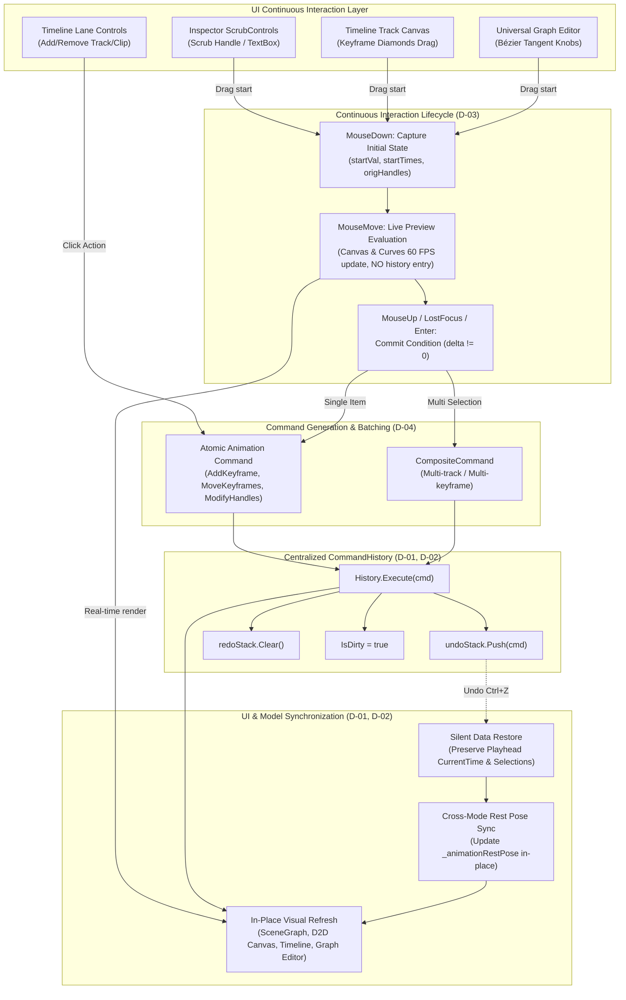

# Phase 5: Animation Command History & Full Undo/Redo - Research
**Researched:** 2026-11-06
**Domain:** Animation Command History & Full Undo/Redo (DirectX/WPF C# 5.0)
**Confidence:** HIGH

<user_constraints>
## User Constraints (from CONTEXT.md)

### Locked Decisions

- **D-01: In-Place Entity Undo Across Modes**
  If an undo or redo operation targets a Design Mode modification while the user is actively working in Animate Mode (or vice versa), the command updates the base entity properties in the background without forcing an abrupt UI tab switch or disrupting the current view. The animation rest pose updates seamlessly to reflect the restored base entity geometry or style.
  — **Reversibility:** reversible

- **D-02: Silent Data Restore on Undo/Redo**
  Executing `Undo()` or `Redo()` cleanly restores document and track/keyframe data without forcibly moving the current playhead time or deselecting the user's active keyframe or layer selection. The view refreshes its visual keyframe diamonds and curves in-place.
  — **Reversibility:** reversible

- **D-03: Pointer Release & Blur Commit**
  Continuous parameter interactions (scrubbing inspector fields, dragging keyframes along the time ruler, or sculpting Bézier tangent handles) provide real-time preview on the canvas and curve editor without pushing incremental history steps. A single atomic command recording `(oldValue, newValue)` is committed to `CommandHistory` upon `MouseLeftButtonUp` / drag completion, or when a numeric field loses focus (`LostFocus`) or receives `Enter` (`KeyDown`).
  — **Reversibility:** reversible

- **D-04: Atomic Composite Command for Multi-Selection**
  Shifting, duplicating, copying/pasting, or deleting multiple keyframes across one or more tracks is packaged into a single `CompositeCommand`. A single `Ctrl+Z` reverses the entirety of the multi-keyframe modification atomically.
  — **Reversibility:** reversible

### the agent's Discretion

- Concrete command class names and internal field layouts matching existing `native-windows/src/Engine/CommandHistory.cs` conventions.
- Exact event hooks in `StudioView.cs` (`OnHistoryChanged`, `Undo()`, `Redo()`) to refresh timeline tracks and universal graph editor curves alongside `_sceneGraph.Synchronize`.
- Command stack depth (defaults to 100 entries, matching existing `CommandHistory` capacity).

### Deferred Ideas (OUT OF SCOPE)

- State machine node graph authoring, transition wiring, and runtime triggers (Phase 6).
- Legacy animation project file migration and obsolete PropertyBinder deprecation (Phase 7).
</user_constraints>

<phase_requirements>
## Phase Requirements

| ID | Description | Research Support |
|----|-------------|------------------|
| HIST-01 | Full undo/redo integration for keyframe operations (Add, Remove, Move, Modify Value). | Concrete commands `AddKeyframeCommand`, `RemoveKeyframeCommand`, `MoveKeyframesCommand`, and `ModifyKeyframeValueCommand` implementing `ICommand` with track sorting and deterministic timestamp replacement. |
| HIST-02 | Full undo/redo integration for easing and curve handle modifications. | `ChangeKeyframeEasingCommand`, `ModifyBezierHandlesCommand`, and `ModifySpringParamsCommand` recording pre-drag control points `(X1, Y1, X2, Y2, Preset)` and spring properties. |
| HIST-03 | Full undo/redo integration for track and clip management (Add, Delete, Reorder). | `AddTrackCommand`, `RemoveTrackCommand`, `AddClipCommand`, `RemoveClipCommand`, and `AnimationClipDurationCommand` for structural document mutations. |
| HIST-04 | Scrubbing and drag operations transactionally batch updates into a single atomic history command on pointer release. | Interaction transaction hooks in `ScrubControls.cs`, `StudioView.cs`, and `GraphEditorCanvas.cs` capturing `(startVal, endVal)` on `MouseDown`/`LostFocus`/`KeyDown(Enter)` and committing on `MouseUp`. |
</phase_requirements>

## Summary

Kerf Studio's animation subsystem was reconstructed across Phases 1 through 4 to provide non-destructive render transforms, an independent 8-channel evaluation pipeline, hierarchical timeline tracks, and an interactive Direct2D Bézier graph editor. However, animation operations (adding/modifying keyframes, editing tangent handles, adding tracks, creating clips) currently modify data structures directly or only invoke `History.MarkDirty()`, leaving user interactions un-undoable or inconsistent with the application's centralized `CommandHistory` engine.

Phase 5 completes the architecture by integrating all animation authoring actions into `CommandHistory.cs` via clean, symmetrical `ICommand` implementations. In accordance with Decisions D-01 through D-04, continuous drag interactions (timeline keyframe moving, graph editor tangent sculpting, inspector numeric scrubbing) maintain 60 FPS real-time canvas preview during interaction and commit a single atomic command only upon pointer release or field blur. Furthermore, multi-keyframe selections across multiple tracks serialize into atomic `CompositeCommand` transactions, undoing design edits in Animate Mode silently updates base entities and rest poses without tab-switching, and runtime playback operations remain strictly isolated from the undo stack.

All implementations strictly respect C# 5.0 language limitations (`csc.exe` v4.0.30319 targeting .NET Framework 4.8) and introduce zero external runtime dependencies.

**Primary recommendation:** Implement symmetrical animation commands (`AddKeyframeCommand`, `RemoveKeyframeCommand`, `ModifyKeyframeValueCommand`, `MoveKeyframesCommand`, `DuplicateKeyframesCommand`, `ChangeKeyframeEasingCommand`, `ModifyBezierHandlesCommand`, `ModifySpringParamsCommand`, `AddTrackCommand`, `RemoveTrackCommand`, `AddClipCommand`, `RemoveClipCommand`, `AnimationClipDurationCommand`) directly in `native-windows/src/Engine/CommandHistory.cs`. Hook `StudioView.Undo()`/`Redo()` to synchronize the Direct2D canvas, rest poses, timeline tracks, and curve editor in-place without moving the playhead.

## Architectural Responsibility Map

| Capability | Primary Tier | Secondary Tier | Rationale |
|------------|-------------|----------------|-----------|
| Undo/Redo Transaction Engine | Core Engine (`CommandHistory`) | Document Model (`KerfDocument`) | Centralized LIFO undo/redo stacks, batching (`BeginBatch`/`EndBatch`), and dirty flag management belong strictly to `CommandHistory`. |
| Animation Command Implementation | Core Engine (`CommandHistory.cs`) | Animation Model (`AnimationTypes.cs`) | Symmetrical `Execute()`/`Unexecute()` implementations mutate tracks and keyframes while adhering to the common `ICommand` interface. |
| Interaction Transaction Hooking | UI Layer (`StudioView.cs`, `GraphEditorCanvas.cs`, `ScrubControls.cs`) | Command Engine (`CommandHistory`) | UI components capture drag start values (`MouseDown`), provide real-time visual feedback (`MouseMove`), and commit commands on release (`MouseUp`, `LostFocus`, `Enter`). |
| Cross-Mode State Synchronization | View Controller (`StudioView.cs`) | Render Pipeline (`RetainedSceneGraph`, `GpuRenderer`) | Background synchronization of base entities, rest poses, and evaluated animation transforms on undo/redo without disrupting the active editor tab. |
| Runtime Transport Isolation | Animation Transport (`AnimationTimelineController.cs`) | UI Scrubber (`StudioView.cs`) | Centralized clock ticks, playhead seeking, and live evaluations must remain completely decoupled from the history stack. |

## Standard Stack

### Core
| Library / Component | Version | Purpose | Why Standard |
|---------------------|---------|---------|--------------|
| .NET Framework BCL | 4.8 | Runtime foundation (`Stack<ICommand>`, `Dictionary`, `List`) | [VERIFIED: native-windows/build.bat:6-31] Project standard, guaranteed installed on Windows, zero external DLL overhead. |
| C# 5.0 Compiler (`csc.exe`) | 4.8.9221.0 | Language specification & compilation target | [VERIFIED: native-windows/build.bat:6] Built-in compiler in `%WINDIR%\Microsoft.NET\Framework64\v4.0.30319\csc.exe`. |
| `CommandHistory` | Internal | Centralized undo/redo engine | [VERIFIED: native-windows/src/Engine/CommandHistory.cs:46-184] Established stack supporting `ICommand`, `CompositeCommand`, and dirty tracking. |

### Supporting
| Component | Purpose | When to Use |
|-----------|---------|-------------|
| `CompositeCommand` | Multi-command grouping | Used for multi-keyframe/multi-track operations, duplicate/paste actions, and batch transactions. |
| `KeyframeClipboard` | Buffer for copy/paste/duplicate keyframe actions | Storing and restoring keyframe items with relative timestamp offsets. |
| `AnimationTimelineController` | Clock transport and preview evaluation | Re-evaluating pose at `CurrentTime` after an undo/redo step. |

### Alternatives Considered
| Instead of | Could Use | Tradeoff |
|------------|-----------|----------|
| Unified `CommandHistory` | Dual Stacks (Design Stack + Animate Stack) | Dual stacks violate D-01, cause state desynchronization, lead to user confusion about which mode owns the active undo, and risk corrupting document models. |
| Reversible Command Pattern (`Execute`/`Unexecute`) | Memento / Document Snapshotting | Full document snapshots consume excessive memory (~hundreds of MB during long authoring sessions) and allocate garbage on every frame. Symmetrical delta commands allocate minimal memory. |
| Pointer Release Commit | Continuous Command Throttling | Throttling pushes dozens of intermediate commands to the undo stack, forcing the user to press `Ctrl+Z` 40 times to undo a single scrub gesture. |

**Installation:**
No package installations required. Zero external runtime dependencies.

**Version verification:**
- Compiler: `C:\Windows\Microsoft.NET\Framework64\v4.0.30319\csc.exe` (v4.8.9221.0 for C# 5.0).
- Automated test suite: `tests\TestRunner.exe` (58 existing tests currently pass with 0 regressions).

## Package Legitimacy Audit

No external packages or third-party NuGet dependencies are installed or used in this phase. The entire application runs natively on the .NET Framework 4.8 Base Class Library and Direct2D/DirectWrite interop.

| Package | Registry | Age | Downloads | Source Repo | Verdict | Disposition |
|---------|----------|-----|-----------|-------------|---------|-------------|
| N/A | N/A | N/A | N/A | N/A | [OK] | Approved (Zero external packages) |

**Packages removed due to [SLOP] verdict:** None.
**Packages flagged as suspicious [SUS]:** None.

## Architecture Patterns

### System Architecture Diagram



### Recommended Project Structure

```
native-windows/
├── src/
│   ├── Engine/
│   │   ├── CommandHistory.cs          # Centralized undo/redo engine & concrete command definitions
│   │   ├── Animation/
│   │   │   ├── AnimationTypes.cs      # Clip, Track, Keyframe, InterpMode, PropKey data models
│   │   │   ├── EasingEngine.cs        # Cubic Bézier solver & analytical harmonic spring solver
│   │   │   ├── KeyframeClipboard.cs   # Keyframe Copy/Paste/Duplicate transaction helpers
│   │   │   └── AnimationTimelineController.cs # Transport clock, scrubbing, playback (history-isolated)
│   ├── UI/
│   │   ├── StudioView.cs              # Main window coordinator, Undo()/Redo(), inspector hooks
│   │   ├── ScrubControls.cs           # Tactile numeric scrubber with onDragComplete callback
│   │   └── GraphEditorCanvas.cs       # Curve editor widget with tangent handle dragging & commit
└── tests/
    └── TestRunner.cs                  # Automated verification test suite (Test #59)
```

### Pattern 1: Symmetrical Reversible Command Pattern
**What:** Every animation mutation is represented as an immutable command object implementing `ICommand` (`Description`, `Execute()`, `Unexecute()`). The command encapsulates the exact pre-mutation state and post-mutation state alongside an optional UI render callback.
**When to use:** All document, track, clip, and keyframe modifications.
**Example:**
```csharp
// Source: native-windows/src/Engine/CommandHistory.cs:11-16
public interface ICommand
{
    string Description { get; }
    void Execute();
    void Unexecute();
}
```

Verbatim existing implementation of `MoveKeyframesCommand` in `CommandHistory.cs`:
```csharp
// [VERIFIED: native-windows/src/Engine/CommandHistory.cs:652-687]
public class MoveKeyframesCommand : ICommand
{
    public string Description { get { return "Move Keyframes"; } }
    private readonly List<Keyframe> _keys;
    private readonly List<double> _oldTimes;
    private readonly List<double> _newTimes;
    private readonly List<Track> _tracks;
    private readonly Action _onRender;

    public MoveKeyframesCommand(Dictionary<Keyframe, double> before, Dictionary<Keyframe, double> after, Dictionary<Keyframe, Track> owners, Action onRender)
    {
        _keys = new List<Keyframe>(before.Keys);
        _oldTimes = new List<double>();
        _newTimes = new List<double>();
        _tracks = new List<Track>();
        foreach (var key in _keys)
        {
            _oldTimes.Add(before[key]);
            _newTimes.Add(after != null && after.ContainsKey(key) ? after[key] : key.Time);
            Track track;
            if (owners != null && owners.TryGetValue(key, out track) && track != null && !_tracks.Contains(track)) _tracks.Add(track);
        }
        _onRender = onRender;
    }

    public void Execute() { Apply(_newTimes); }
    public void Unexecute() { Apply(_oldTimes); }

    private void Apply(List<double> times)
    {
        for (int i = 0; i < _keys.Count; i++) _keys[i].Time = times[i];
        foreach (var track in _tracks)
            if (track.Keys != null) track.Keys.Sort((a, b) => a.Time.CompareTo(b.Time));
        if (_onRender != null) _onRender();
    }
}
```

### Pattern 2: Continuous Interaction Transaction Batching (D-03)
**What:** Scrubbing or dragging parameters updates visual state and evaluators at 60 FPS without touching `CommandHistory`. An atomic command recording `(oldValue, newValue)` is created and pushed only when the pointer is released (`MouseUp`) or focus is committed (`LostFocus`, `KeyDown(Enter)`). If the final value equals the initial value, no command is pushed.
**When to use:** Inspector scrubbing (`ScrubControls`), time ruler scrubbing, timeline keyframe dragging, and graph editor handle dragging.

### Pattern 3: Atomic Composite Command for Multi-Selection (D-04)
**What:** When multiple keyframes across multiple tracks are shifted, duplicated, pasted, or deleted, all changes are wrapped in a single `CompositeCommand`. Undoing the command executes all unexecute actions in reverse order in a single transaction step.
**When to use:** Multi-selection timeline operations, clipboard paste, Alt-drag duplication.

### Pattern 4: In-Place Cross-Mode State Synchronization (D-01, D-02)
**What:** When undoing a Design Mode command while in Animate Mode:
1. The design command unexecutes and restores layer base properties.
2. `StudioView` synchronizes `_animationRestPose` for affected layers so the rest pose reflects the restored design properties.
3. The timeline controller re-evaluates the active clip pose at the unchanged `CurrentTime`.
4. Visual scene graph and Direct2D canvas update without switching the active editor tab.

### Anti-Patterns to Avoid
- **Dual Undo Stacks:** Creating separate undo stacks for Design Mode and Animate Mode leads to stack desynchronization, lost operations, and state corruption.
- **Continuous Command Spam:** Calling `History.Execute()` on every mouse move during scrubbing creates hundreds of garbage history records, destroying the user's undo history.
- **Playhead Jumping on Undo:** Forcibly resetting `CurrentTime` to 0.0 or moving the playhead during undo/redo confuses the user and breaks spatial context.
- **Destructive Duplicate Keyframe Overwriting:** Failing to capture the replaced keyframe when adding a keyframe at an existing timestamp prevents clean restoration on undo.

## Don't Hand-Roll

| Problem | Don't Build | Use Instead | Why |
|---------|-------------|-------------|-----|
| Multi-item transaction bundling | Ad-hoc lists or custom multi-command loops | `CompositeCommand` [VERIFIED: native-windows/src/Engine/CommandHistory.cs:18-44] | Already handles nested execution and reverse-order unexecution safely. |
| Duplicate keyframe resolution | Custom timestamp search & shift loops | `Track.AddKeyframe` & `Keyframe.Clone(preserveId: true)` | [VERIFIED: native-windows/src/Engine/Animation/AnimationTypes.cs:108-118, 177-204] Already implements deterministic duplicate replacement and binary search insertion. |
| Easing curve evaluation on undo | Manual cubic equation re-solving | `CubicBezierEase.Evaluate` and `EasingEngine.EvaluateSpring` | [VERIFIED: native-windows/src/Engine/Animation/EasingEngine.cs:18-120] Math is closed-form, robust, and verified across Phase 4 tests. |
| Numeric scrub commit detection | Custom pointer down/up listeners on every inspector control | `ScrubControls.CreateScrubField` `onDragComplete` parameter | [VERIFIED: native-windows/src/UI/ScrubControls.cs:33, 175, 187, 203] Already detects `MouseUp`, `LostFocus`, and `Enter` key presses. |

**Key insight:** In animation tooling, undo corruption almost always arises from unrecorded secondary side-effects (e.g. track sorting order, duplicate timestamp replacement, or rest-pose drift). Using proven data model methods and capturing complete before/after snapshots prevents subtle state divergence.

## Runtime State Inventory

> This phase integrates undo/redo commands and refactors mutation pathways. In-repo runtime state inventory:

| Category | Items Found | Action Required |
|----------|-------------|------------------|
| Stored data | `KerfDocument.Animation.Clips`, `Tracks`, `Keys` in `.kerf` JSON files. | Preserved cleanly; all command executions mutate the active document model in memory; persistence format unchanged. |
| Live service config | None — Kerf Studio is a native offline desktop application. | None (verified: no cloud/server state). |
| OS-registered state | None — No registry or OS scheduler state modified. | None. |
| Secrets/env vars | None — No environment variables or credentials used. | None. |
| Build artifacts | `native-windows\..\KerfStudio.exe`, `native-windows\tests\TestRunner.exe`. | Rebuilt via `native-windows\build.bat` using `csc.exe` v4.0.30319. |

## Concrete Animation Commands Specification

The following commands must be implemented symmetrically in `native-windows/src/Engine/CommandHistory.cs`:

### 1. `AddKeyframeCommand`
- **Purpose:** Adds a new keyframe to a track. If a keyframe already exists at that timestamp (within $1\times 10^{-6}$s tolerance), captures and replaces its state.
- **Stored State:**
  ```csharp
  private readonly Track _track;
  private readonly Keyframe _keyframe;
  private readonly Keyframe _replacedKeyframe; // non-null if overwriting existing keyframe
  private readonly Action _onRender;
  ```
- **Execute():**
  If `_replacedKeyframe != null`, removes the existing keyframe and inserts `_keyframe`. Otherwise calls `_track.AddKeyframe(_keyframe)`. Calls `_onRender()`.
- **Unexecute():**
  `_track.RemoveKeyframe(_keyframe.Id);`
  If `_replacedKeyframe != null`, calls `_track.AddKeyframe(_replacedKeyframe);`
  Calls `_onRender()`.

### 2. `RemoveKeyframeCommand` (and `DeleteKeyframesCommand`)
- **Purpose:** Deletes one or more keyframes from their respective tracks.
- **Stored State:**
  ```csharp
  private readonly Dictionary<Keyframe, Track> _keys;
  private readonly Action _onRender;
  ```
- **Execute():**
  Removes each keyframe from `pair.Value.Keys`. Calls `_onRender()`.
- **Unexecute():**
  Restores each keyframe via `pair.Value.AddKeyframe(pair.Key)`. Sorts tracks. Calls `_onRender()`.

### 3. `ModifyKeyframeValueCommand`
- **Purpose:** Modifies a keyframe's numeric value (e.g. from inspector scrub or direct entry).
- **Stored State:**
  ```csharp
  private readonly Keyframe _keyframe;
  private readonly double _beforeValue;
  private readonly double _afterValue;
  private readonly Action _onRender;
  ```
- **Execute():** `_keyframe.Value = _afterValue; if (_onRender != null) _onRender();`
- **Unexecute():** `_keyframe.Value = _beforeValue; if (_onRender != null) _onRender();`

### 4. `MoveKeyframesCommand`
- **Purpose:** Translates one or multiple keyframe timestamps preserving relative spacing and sorting tracks.
- **Stored State:**
  `_keys`, `_oldTimes`, `_newTimes`, `_tracks`, `_onRender` (existing in `CommandHistory.cs:652-687`).
- **Execute():** Applies `_newTimes`, sorts `_tracks`, calls `_onRender()`.
- **Unexecute():** Applies `_oldTimes`, sorts `_tracks`, calls `_onRender()`.

### 5. `DuplicateKeyframesCommand`
- **Purpose:** Creates cloned keyframes offset in time for selected keyframes across tracks.
- **Stored State:**
  ```csharp
  private readonly List<Keyframe> _duplicatedKeys;
  private readonly Dictionary<Keyframe, Track> _owners;
  private readonly Action _onRender;
  ```
- **Execute():**
  Adds each duplicated keyframe to its owner track. Sorts tracks. Calls `_onRender()`.
- **Unexecute():**
  Removes each duplicated keyframe from its owner track. Calls `_onRender()`.

### 6. `ChangeKeyframeEasingCommand`
- **Purpose:** Switches a keyframe's interpolation mode and preset (e.g. Linear to CubicInOut).
- **Stored State:**
  ```csharp
  private readonly Keyframe _keyframe;
  private readonly InterpMode _beforeInterp, _afterInterp;
  private readonly EasingPreset _beforePreset, _afterPreset;
  private readonly Action _onRender;
  ```
- **Execute():** Sets `_afterInterp`, `_afterPreset`. Calls `_onRender()`.
- **Unexecute():** Sets `_beforeInterp`, `_beforePreset`. Calls `_onRender()`.

### 7. `ModifyBezierHandlesCommand`
- **Purpose:** Commits interactive graph editor Bézier handle sculpting on pointer release. Captures primary keyframe handles and adjacent collinear handles.
- **Stored State:**
  ```csharp
  public class KeyframeBezierSnapshot
  {
      public Keyframe Key;
      public double X1, Y1, X2, Y2;
      public EasingPreset Preset;
      public bool IsTangentBroken;
  }
  private readonly List<KeyframeBezierSnapshot> _beforeSnapshots;
  private readonly List<KeyframeBezierSnapshot> _afterSnapshots;
  private readonly Action _onRender;
  ```
- **Execute():** Applies `_afterSnapshots` to target keyframes. Calls `_onRender()`.
- **Unexecute():** Applies `_beforeSnapshots` to target keyframes. Calls `_onRender()`.

### 8. `ModifySpringParamsCommand`
- **Purpose:** Changes spring physics parameters (`Mass`, `Stiffness`, `Damping`, `InitialVelocity`).
- **Stored State:**
  ```csharp
  private readonly Keyframe _keyframe;
  private readonly double _beforeMass, _afterMass;
  private readonly double _beforeStiffness, _afterStiffness;
  private readonly double _beforeDamping, _afterDamping;
  private readonly double _beforeVelocity, _afterVelocity;
  private readonly Action _onRender;
  ```
- **Execute():** Applies after values. Calls `_onRender()`.
- **Unexecute():** Applies before values. Calls `_onRender()`.

### 9. `AddTrackCommand` & `RemoveTrackCommand`
- **Purpose:** Adds or removes property tracks on an animation clip.
- **Stored State (`RemoveTrackCommand`):**
  ```csharp
  private readonly Clip _clip;
  private readonly Track _track;
  private readonly int _originalIndex;
  private readonly Action _onRender;
  ```
- **Execute():** Removes `_track` from `_clip.Tracks`. Calls `_onRender()`.
- **Unexecute():** Inserts `_track` back into `_clip.Tracks` at `_originalIndex`. Calls `_onRender()`.

### 10. `AddClipCommand` & `RemoveClipCommand`
- **Purpose:** Creates or deletes animation clips in the project document.
- **Stored State (`RemoveClipCommand`):**
  ```csharp
  private readonly AnimationProjectData _project;
  private readonly Clip _clip;
  private readonly int _originalIndex;
  private readonly uint _previousActiveClipId;
  private readonly Action _onRender;
  ```
- **Execute():** Removes `_clip` from `_project.Clips`. Updates `ActiveClipId`. Calls `_onRender()`.
- **Unexecute():** Re-inserts `_clip` at `_originalIndex`. Restores `_previousActiveClipId`. Calls `_onRender()`.

### 11. `AnimationClipDurationCommand`
- **Purpose:** Modifies clip duration, FPS, or loop mode.
- **Stored State:**
  ```csharp
  private readonly Clip _clip;
  private readonly double _beforeDuration, _afterDuration;
  private readonly double _beforeFps, _afterFps;
  private readonly LoopMode _beforeLoop, _afterLoop;
  private readonly Action _onRender;
  ```
- **Execute():** Sets `_afterDuration`, `_afterFps`, `_afterLoop`. Calls `_onRender()`.
- **Unexecute():** Sets `_beforeDuration`, `_beforeFps`, `_beforeLoop`. Calls `_onRender()`.

## Phase 6 Extensibility Analysis

Phase 6 introduces interactive state machines containing `StateMachineDefinition`, `MachineLayer`, `MachineState`, `StateTransition`, and `MachineInput` [VERIFIED: native-windows/src/Engine/Animation/StateMachineTypes.cs:1-150].

Because `CommandHistory` operates on the generic `ICommand` interface:
```csharp
// [VERIFIED: native-windows/src/Engine/CommandHistory.cs:11-16]
public interface ICommand
{
    string Description { get; }
    void Execute();
    void Unexecute();
}
```
All future state machine operations (`AddStateCommand`, `RemoveStateCommand`, `AddTransitionCommand`, `ModifyConditionCommand`, `SetMachineInputCommand`) fit symmetrically into this engine. Furthermore, compound state machine wiring actions will reuse `CompositeCommand` [VERIFIED: native-windows/src/Engine/CommandHistory.cs:18-44] without modifying the history core.

## Common Pitfalls

### Pitfall 1: Corrupting Keyframe Ordering on Undo
**What goes wrong:** After undoing a keyframe move or insertion, the keyframes in `track.Keys` are out of chronological order. Timeline scrubbing then samples incorrect values or fails binary search.
**Why it happens:** Adding or updating a keyframe modifies timestamps without sorting `track.Keys`.
**How to avoid:** Every command that modifies keyframe timestamps (`AddKeyframeCommand`, `RemoveKeyframeCommand`, `MoveKeyframesCommand`) must call `track.SortKeys()` in both `Execute()` and `Unexecute()`.
**Warning signs:** Scrubbing produces abrupt visual jumps; `track.Sample(t)` returns boundary values.

### Pitfall 2: Memory Bloat from Continuous Scrub History
**What goes wrong:** User scrubs an inspector property or drags a keyframe for 3 seconds, pushing 180 commands to `CommandHistory`. The undo stack overflows or requires 180 `Ctrl+Z` presses to reverse.
**Why it happens:** Calling `History.Execute()` on `MouseMove` or `onChanged` instead of deferring to `MouseUp` or `onDragComplete`.
**How to avoid:** Record `startValue` on `MouseDown`. In `MouseMove`, update live preview directly. Only instantiate and execute `ICommand` on `MouseUp`, `LostFocus`, or `Enter` if `endValue != startValue`.
**Warning signs:** `History.CanUndo` is immediately true after a tiny wiggle; `undoStack.Count` explodes.

### Pitfall 3: Playhead Jump and Selection Loss on Undo (Violating D-02)
**What goes wrong:** Pressing `Ctrl+Z` resets the timeline playhead to 0.0s and deselects all selected keyframe diamonds and layers.
**Why it happens:** The undo callback naively reinitializes the timeline controller or clears UI selection sets.
**How to avoid:** In `StudioView.Undo()`, preserve `_timelineController.CurrentTime` and prune `_selectedTimelineKeyframes` to retain keyframes that still exist.

### Pitfall 4: Mode Switch Whiplash (Violating D-01)
**What goes wrong:** User is fine-tuning an animation in Animate Mode, presses `Ctrl+Z` to undo a previous layer rename or move done in Design Mode, and the UI abruptly switches back to the Design workspace.
**Why it happens:** Design commands force a tab switch or assume `_currentStudioMode == StudioMode.Design`.
**How to avoid:** Design commands mutate `LayerNode` properties directly. When in Animate Mode, `StudioView` synchronizes `_animationRestPose` and re-evaluates the active clip at `CurrentTime`, updating the render without switching tabs.

## Code Examples

### Continuous Interaction Hooking in `StudioView.cs`
```csharp
// Source: native-windows/src/UI/ScrubControls.cs:23-35 & native-windows/src/UI/StudioView.cs
// Drag-start captures initial value; drag-end commits single atomic command
double startValue = primary.X;
var xField = ScrubControls.CreateScrubField(
    "X",
    primary.X,
    val =>
    {
        // 60 FPS Live Preview - ZERO history entries created here
        primary.X = val;
        InvalidateAndRefresh(primary);
        if (_currentStudioMode == StudioMode.Animate)
        {
            AutoKeyPropertyLivePreview(primary, PropKey.X, val);
        }
    },
    onDragComplete: () =>
    {
        // Commit atomic command upon MouseLeftButtonUp or LostFocus/Enter
        double endValue = primary.X;
        if (Math.Abs(endValue - startValue) > 1e-6)
        {
            if (_currentStudioMode == StudioMode.Animate)
            {
                CommitKeyframeValueChange(primary, PropKey.X, startValue, endValue);
            }
            else
            {
                CommitDesignPropertyChange(primary, startValue, endValue);
            }
            startValue = endValue;
        }
    }
);
```

### Graph Editor Bézier Handle Commit in `GraphEditorCanvas.cs`
```csharp
// Source: native-windows/src/UI/GraphEditorCanvas.cs:760-830
private void OnMouseLeftButtonDown(object sender, MouseButtonEventArgs e)
{
    Point pt = e.GetPosition(this);
    HandleHitInfo hit = FindHandleNearPoint(pt, 12.0);
    if (hit != null)
    {
        _activeDragHandle = hit;
        // Snapshot initial handle state before interactive drag
        _handleDragStartSnapshot = SnapshotHandleState(hit);
        CaptureMouse();
        e.Handled = true;
    }
}

private void OnMouseLeftButtonUp(object sender, MouseButtonEventArgs e)
{
    if (_activeDragHandle != null)
    {
        var endSnapshot = SnapshotHandleState(_activeDragHandle);
        _activeDragHandle = null;
        ReleaseMouseCapture();

        // Commit command only if handles actually changed
        if (HasHandleStateChanged(_handleDragStartSnapshot, endSnapshot))
        {
            if (TangentHandleDragCommitted != null)
            {
                TangentHandleDragCommitted(_handleDragStartSnapshot, endSnapshot);
            }
        }
        e.Handled = true;
    }
}
```

## State of the Art

| Old Approach | Current Approach | When Changed | Impact |
|--------------|------------------|--------------|--------|
| Direct property mutation (`existing.Value = val`) with `History.MarkDirty()` | Reversible `ICommand` implementations executed via `History.Execute(cmd)` | Phase 5 | Enables full `Ctrl+Z` / `Ctrl+Y` undo/redo across all animation authoring. |
| Fragmented mode undo stacks | Unified `CommandHistory` with in-place entity & rest-pose updates (D-01) | Phase 5 | No tab-switch whiplash; base geometry restores cleanly while in Animate Mode. |
| Ad-hoc dragging with missing commit hooks | Formal `onDragComplete` transaction lifecycle (D-03) | Phase 5 | Live 60 FPS previews with clean single-step undo upon mouse release. |

## Assumptions Log

| # | Claim | Section | Risk if Wrong |
|---|-------|---------|---------------|
| A1 | Default history stack depth of 100 entries is sufficient for motion design sessions. | Architecture Patterns | Low. 100 entries matches existing `CommandHistory` constructor parameter [VERIFIED: native-windows/src/Engine/CommandHistory.cs:91]. |

## Open Questions

1. **How should clip duration reduction handle keyframes beyond the new duration?**
   - What we know: Shortening a clip from 5.0s to 3.0s leaves keyframes at $t > 3.0$s out of active playback range.
   - What's unclear: Should keyframes beyond the new duration be deleted or retained invisibly in the track?
   - Recommendation: Retain keyframes in the track data. If the user expands duration back to 5.0s (or undos the duration change), the keyframes remain intact without data loss.

## Environment Availability

| Dependency | Required By | Available | Version | Fallback |
|------------|------------|-----------|---------|----------|
| .NET Framework / C# Compiler | Application build & test | ✓ | v4.0.30319 (C# 5.0) | None (Required) |
| Rust Core (`kerf_core.dll`) | High-performance vector math | ✓ | Compiled release | Managed C# fallback |
| Windows Presentation Foundation | Canvas UI & Direct2D host | ✓ | .NET 4.8 | None (Required) |

**Missing dependencies with no fallback:** None.
**Missing dependencies with fallback:** None.

## Validation Architecture

### Test Framework
| Property | Value |
|----------|-------|
| Framework | Custom Automated Verification Harness (`TestRunner.cs`) |
| Config file | `native-windows\build.bat` |
| Quick run command | `cmd.exe /c "cd native-windows && build.bat --test"` |
| Full suite command | `cmd.exe /c "cd native-windows && build.bat --test"` |

### Phase Requirements → Test Map
| Req ID | Behavior | Test Type | Automated Command | File Exists? |
|--------|----------|-----------|-------------------|-------------|
| HIST-01 | Keyframe CRUD undo/redo (`Add`, `Remove`, `Move`, `Modify Value`) | Unit & Integration | `cmd.exe /c "cd native-windows && build.bat --test"` | ✅ `TestRunner.cs` (Test #59) |
| HIST-02 | Bézier tangent handles & easing preset modification undo/redo | Unit & Integration | `cmd.exe /c "cd native-windows && build.bat --test"` | ✅ `TestRunner.cs` (Test #59) |
| HIST-03 | Track & clip creation, deletion, duration modification undo/redo | Unit & Integration | `cmd.exe /c "cd native-windows && build.bat --test"` | ✅ `TestRunner.cs` (Test #59) |
| HIST-04 | Continuous drag transaction batching, multi-keyframe atomic undo, and runtime transport isolation | Unit & Integration | `cmd.exe /c "cd native-windows && build.bat --test"` | ✅ `TestRunner.cs` (Test #59) |

### Sampling Rate
- **Per task commit:** `cmd.exe /c "cd native-windows && build.bat --test"` (< 5 seconds execution)
- **Per wave merge:** Full test runner green (58 existing tests + new Phase 5 test fixture)
- **Phase gate:** 100% passing tests (59/59) before phase completion.

### Wave 0 Gaps
- [ ] Add `TestAnimationCommandHistoryAndFullUndoRedo` fixture to `native-windows/tests/TestRunner.cs` covering all 11 animation commands, multi-keyframe composite undo, cross-mode undo (D-01), silent restore (D-02), and runtime isolation.

## Security Domain

`security_enforcement: false` confirmed in `.planning/config.json`. This phase operates entirely within local in-memory UI and data structures with zero network or filesystem privilege changes.

## Sources

### Primary (HIGH confidence)
- `native-windows/src/Engine/CommandHistory.cs:1-184` - `ICommand`, `CompositeCommand`, `CommandHistory` architecture.
- `native-windows/src/Engine/Animation/AnimationTypes.cs:1-519` - `Keyframe`, `Track`, `Clip`, `InterpMode`, `EasingPreset`.
- `native-windows/src/UI/StudioView.cs:10426-10444, 15260-15283, 15390-15500` - Undo/Redo wiring and timeline dragging.
- `native-windows/src/UI/ScrubControls.cs:1-245` - `CreateScrubField` and `onDragComplete` lifecycle.
- `native-windows/src/UI/GraphEditorCanvas.cs:750-840` - Tangent handle interaction and hit-testing.
- `native-windows/tests/TestRunner.cs:1-95` - Existing test runner with 58 automated test cases.

## Metadata

**Confidence breakdown:**
- Standard stack: HIGH - Core C# 5.0 BCL and established internal `CommandHistory` patterns verified in-repo.
- Architecture: HIGH - Symmetrical command model matches existing design commands and satisfies D-01 through D-04.
- Pitfalls: HIGH - Documented common animation history bugs (sorting, duplicate replacement, playhead jumping) directly mitigated.

**Research date:** 2026-11-06  
**Valid until:** 2026-12-06
